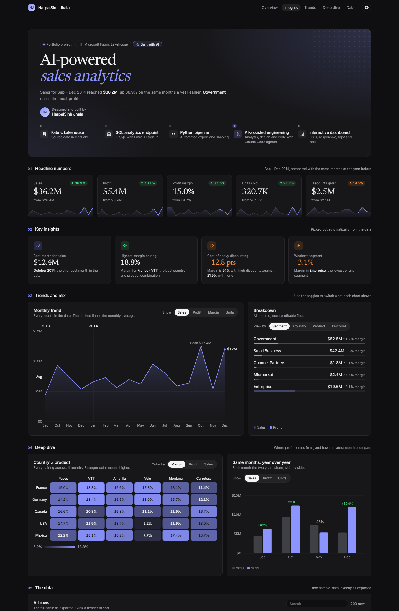

# AI-Powered Sales Analytics

An end-to-end analytics project by **HarpalSinh Jhala**. It takes data from a Microsoft Fabric lakehouse and turns it into an interactive dashboard, built with AI-assisted analytics engineering.

**Live dashboard:** https://harpalsinhjhala13.github.io/ai-sales-analytics/



## How it was built

1. **Microsoft Fabric Lakehouse:** the source table `dbo.sample_data` (Microsoft's financial sample, 700 rows) is stored in OneLake.
2. **SQL analytics endpoint:** the table is queried with T-SQL, signing in with Microsoft Entra ID.
3. **Python pipeline:** `mssql-python` and `azure-identity` export and shape the data.
4. **AI-assisted engineering:** the analysis, dashboard design and code were produced with Claude Code agents, which I directed and reviewed.
5. **Interactive dashboard:** a single self-contained HTML page built with D3.js. It works on phones and has light and dark modes.

## What's in the dashboard

- **Headline numbers:** sales, profit, margin, units and discounts for Sep–Dec 2014 against the same months of 2013. Each card has a change arrow and a small trend line.
- **Key insights**, picked out automatically from the data:
  - the best month
  - the highest-margin country and product pair
  - the cost of heavy discounting
  - the weakest segment
- **Monthly trend:** switches between sales, profit, margin and units.
- **Breakdown:** by segment, country, product or discount band.
- **Country × product heatmap:** colored by margin, profit or sales.
- **Year over year:** the months both years share, side by side, with growth labels.
- **The data:** a searchable, sortable table of every row.

## Project structure

| Path | What it is |
|---|---|
| `docs/index.html` | The finished dashboard, with the data built in. GitHub Pages serves this file. |
| `dashboard/index.html` | The source for the dashboard page. |
| `data/sample_data.csv` | The exported `dbo.sample_data` table. |
| `scripts/fetch_sample.py` | Exports the table from the Fabric SQL analytics endpoint after a browser sign-in. |
| `scripts/build_site.py` | Combines the page source and the CSV into `docs/index.html`. |
| `assets/preview.png` | The screenshot above. |

## Refresh the data and rebuild

```bash
pip install mssql-python azure-identity requests
set FABRIC_SQL_ENDPOINT=<your-endpoint>.datawarehouse.fabric.microsoft.com
python scripts/fetch_sample.py data/sample_data.csv
python scripts/build_site.py
```

Commit and push the updated `docs/index.html`, and GitHub Pages republishes it.

## Tech

Microsoft Fabric (Lakehouse, SQL analytics endpoint) · T-SQL · Python · D3.js · HTML/CSS · Claude Code

---

The data is Microsoft's public financial sample dataset.
